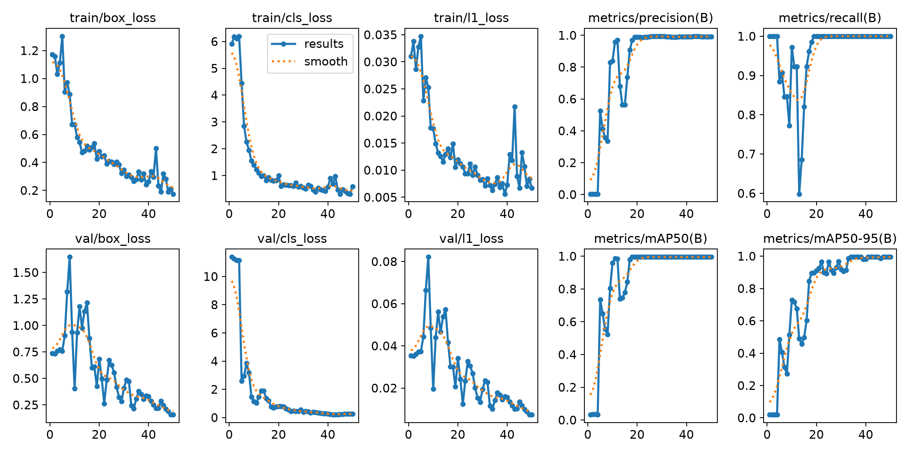
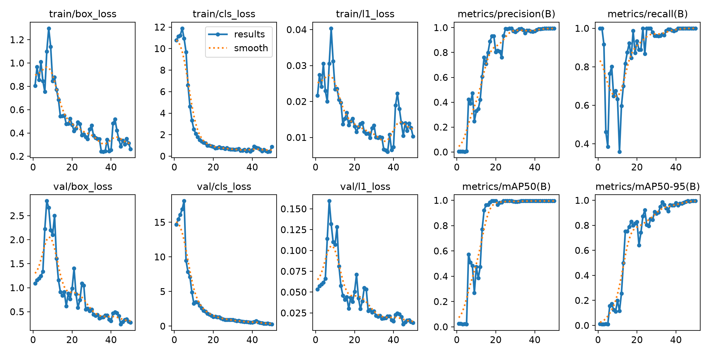
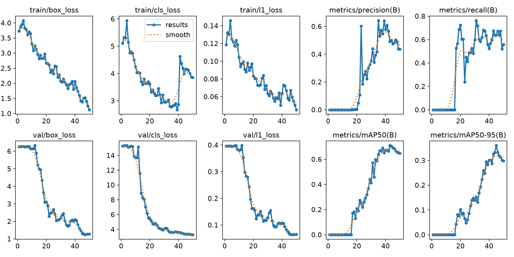
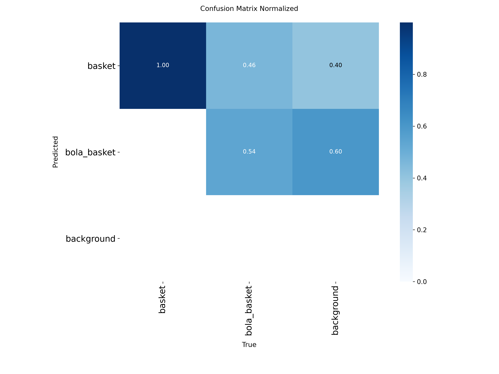
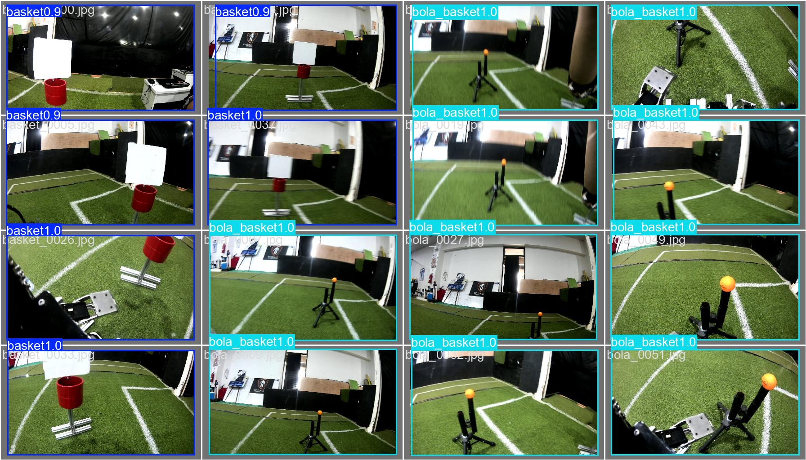

# 🏀 Transfer Learning dengan YOLO26 untuk Deteksi Basket & Bola Basket

Praktik terpadu Minggu 4–7 (RET503): menerapkan **transfer learning** pada YOLO26n (bobot pretrained COCO) agar model dapat mendeteksi basket dan bola basket hanya dengan **97 gambar**. Pelatihan dari nol (E2) dipakai sebagai kontrol untuk membuktikan manfaat transfer learning, bukan sebagai metode utama.


---

## 1. Ringkasan

| Item | Keterangan |
| :-- | :-- |
| Tugas | Deteksi objek 2 kelas: `basket` (0) dan `bola_basket` (1) |
| Model | YOLO26n (nano, ±2,39 juta parameter, 5,4 GFLOPs) |
| Pengaturan sama untuk semua eksperimen | `epochs=50`, `imgsz=416`, `batch=16`, `seed=0`, `deterministic=True` |
| Perangkat keras | NVIDIA GeForce RTX 3050 6GB Laptop GPU, PyTorch 2.14.1 + CUDA |
| Model terpilih | **E1_pretrained** (mAP50-95 val tertinggi) |
| Hasil di data test (sekali uji) | **mAP50 = 0,995 · mAP50-95 = 0,995** |

**Kesimpulan singkat:** transfer learning memungkinkan YOLO26n mencapai mAP50-95 0,995 dengan hanya 97 gambar. Sebagai kontrol, model yang sama tanpa bobot pretrained hanya mencapai 0,360, sehingga data sekecil ini baru memadai jika memakai transfer learning.

---

## 2. Alur Program

```
01_check_annotation.py  →  validasi anotasi + gambar kotak (cek visual)
          ↓
02_split_dataset.py     →  bagi data 70/20/10 + buat data.yaml
          ↓
03_train_model.py       →  latih E1, E2, E3 → pilih terbaik (val) → uji sekali (test)
```

Cara menjalankan ulang:

```bash
python 01_check_annotation.py dataset_yolo
python 02_split_dataset.py dataset_yolo dataset_v1
python 03_train_model.py --nim <NIM> --nama "<Nama>" --data dataset_v1/data.yaml --epochs 50
```

---

## 3. Dataset

Data awal berupa gambar yang dikelompokkan per kelas (`train/basket`, `train/bola_basket`), lalu dikonversi ke struktur YOLO (`images/` dan `labels/`) dengan `konversi_dataset.py`. Setiap gambar diberi satu kotak yang memenuhi seluruh gambar (`class 0.5 0.5 1.0 1.0`).

**Hasil pemeriksaan anotasi (`01_check_annotation.py`):**

| Pemeriksaan | Hasil |
| :-- | :-: |
| Jumlah gambar | 97 |
| Gambar tanpa file label | 0 |
| Label kosong (latar) | 0 |
| Masalah ditemukan | 0 |
| Jumlah kotak `basket` | 48 |
| Jumlah kotak `bola_basket` | 49 |

**Pembagian data (`02_split_dataset.py`, `random.seed(42)`):**

| Subset | Proporsi | Jumlah gambar |
| :-- | :-: | :-: |
| Train | 70% | 67 |
| Validation | 20% | 19 |
| Test | 10% | 11 |
| **Total** | 100% | **97** |

Sidik jari label dataset: `80465D7D70E0`.

---

## 4. Skenario Eksperimen

| Kode | Peran | Bobot awal | Perubahan |
| :-- | :-- | :-- | :-- |
| **E1_pretrained** | **Transfer learning (metode utama / baseline)** | `yolo26n.pt` (COCO) | tidak ada |
| **E2_scratch** | Kontrol: tanpa transfer learning | `yolo26n.yaml` (acak) | tidak ada |
| **E3_tuning** | Tuning pada transfer learning | `yolo26n.pt` (COCO) | **satu perubahan:** `imgsz=640` |

Hanya satu variabel yang diubah per perbandingan, sehingga perbedaan hasil dapat dikaitkan dengan perubahan tersebut.

---

## 5. Hasil (Data Validation)

| Eksperimen | Perubahan | mAP50 | mAP50-95 | Precision | Recall | Inferensi (ms) | Waktu latih (menit) |
| :-- | :-- | :-: | :-: | :-: | :-: | :-: | :-: |
| E1_pretrained | - | **0,995** | **0,995** | 0,992 | 1,000 | 3,5 | 1,2 |
| E2_scratch | - | 0,692 | 0,360 | 0,474 | 0,639 | 2,4 | 0,9 |
| E3_tuning | `imgsz=640` | **0,995** | **0,995** | 0,993 | 1,000 | 4,9 | 1,3 |

**Hasil data test (model terpilih E1_pretrained, diuji sekali):**

| mAP50 | mAP50-95 |
| :-: | :-: |
| 0,995 | 0,995 |

> Data lengkap ada di `hasil_praktik_<NIM>.csv` dan `hasil_praktik_<NIM>.txt`.

---

## 6. Lampiran Gambar

Grafik dibuat otomatis oleh Ultralytics (`plots=True`) di folder `hasil_praktik/`.

### E1_pretrained: kurva pelatihan


### E3_tuning: kurva pelatihan


### E2_scratch: kurva pelatihan (pembanding)


### Confusion matrix E1_pretrained


### Contoh prediksi pada data validasi (E1)


### Pemeriksaan visual anotasi
Gambar dengan kotak anotasi tersimpan di `dataset_yolo/cek_visual/`.

---

## 7. Analisis

### 7.1 Manfaat transfer learning (E1 dibandingkan kontrol E2)
E1 mencapai mAP50-95 **0,995**, sedangkan E2 hanya **0,360**, selisih sekitar **0,635**. Precision (0,992 vs 0,474) dan recall (1,000 vs 0,639) juga jauh berbeda. Penyebabnya adalah titik awal bobot:

- **E1** memakai bobot pretrained COCO yang sudah mengenali tepi, tekstur, dan bentuk umum. Model hanya perlu menyesuaikan *head* untuk dua kelas baru.
- **E2** memulai dari bobot acak, sehingga harus mempelajari fitur visual dasar dari 67 gambar dalam 50 epoch. Data sebanyak itu tidak cukup, hasilnya model belum konvergen dan **underfitting**.

Hal ini sejalan dengan teori: pelatihan dari nol biasanya membutuhkan ribuan gambar atau lebih, sedangkan transfer learning cukup dengan data kecil.

### 7.2 Pengaruh tuning `imgsz` (E1 vs E3)
Menaikkan `imgsz` dari 416 ke 640 **tidak mengubah** mAP50 maupun mAP50-95 (keduanya 0,995). Precision naik sangat tipis (0,992 → 0,993), tetapi biayanya nyata:

- Latensi inferensi naik dari 3,5 ms menjadi 4,9 ms (±40% lebih lambat).
- Waktu latih naik dari 1,2 menjadi 1,3 menit.

Untuk dataset ini, resolusi 416 sudah cukup, dan manfaat resolusi lebih tinggi tidak terlihat. Pada aplikasi real-time di robot, 416 lebih menguntungkan karena lebih cepat dengan akurasi yang sama.

### 7.3 Pemilihan model dan hasil test
Model dipilih berdasarkan mAP50-95 pada data **validation**. E1 dan E3 memiliki nilai yang sama pada tiga angka desimal, sehingga **E1** yang dipakai karena lebih ringan dan lebih cepat. Model ini diuji **sekali** pada 11 gambar test dan memperoleh mAP50 = 0,995 dan mAP50-95 = 0,995, konsisten dengan hasil validasi dan tidak menunjukkan tanda overfitting terhadap data validasi.

### 7.4 Keterbatasan (penting untuk interpretasi)
1. **Dataset kecil.** Data test hanya 11 gambar dan validasi 19 gambar, sehingga satu kesalahan saja dapat mengubah metrik secara signifikan. Selang kepercayaan hasil ini lebar.
2. **Anotasi bersifat satu kotak penuh per gambar.** Karena label dibuat otomatis (`0.5 0.5 1.0 1.0`), tugas yang dipelajari lebih mirip klasifikasi gambar daripada deteksi lokasi objek. Skor 0,995 di sini mudah dicapai dan **belum menunjukkan kemampuan model mendeteksi objek kecil, banyak objek, atau latar kompleks**.
3. **Skor mendekati batas atas.** Nilai 0,995 adalah batas praktis metrik mAP50 di Ultralytics untuk data ini, sehingga E1 dan E3 tidak bisa dibedakan. Perbandingan yang lebih tajam membutuhkan data yang lebih sulit atau lebih banyak.
4. **Satu kali pelatihan per eksperimen** (`seed=0`). Variasi antar-seed belum diukur.

### 7.5 Saran pengembangan
- Anotasi ulang dengan kotak yang pas pada objek (misalnya memakai CVAT atau Roboflow) dan tambahkan gambar dengan beberapa objek sekaligus.
- Perbanyak data dan tambahkan gambar latar tanpa objek agar model belajar membedakan objek dari latar.
- Ulangi eksperimen dengan beberapa seed dan laporkan rata-rata serta simpangan.
- Uji pada video atau kamera langsung untuk menilai FPS dan ketahanan di kondisi nyata.

---

## 8. Struktur Repositori

```text
yolo/
├── 01_check_annotation.py
├── 02_split_dataset.py
├── 03_train_model.py
├── konversi_dataset.py
├── dataset_v1/               # hasil split (data.yaml, images/, labels/)
├── hasil_praktik/            # grafik tiap eksperimen (E1, E2, E3)
├── hasil_praktik_<NIM>.txt   # laporan ringkas
├── hasil_praktik_<NIM>.csv   # tabel hasil eksperimen
└── README.md
```

> File bobot `*.pt`, folder `venv/`, dan `runs/` tidak ikut diunggah (lihat `.gitignore`).

---

## 9. Pemetaan terhadap Tugas (Tahap 4–6)

| Bagian | Yang dikumpulkan | Lokasi di repositori |
| :-- | :-- | :-- |
| Tahap 4–6 | `hasil_praktik_<NIM>.txt` / `.csv` | root folder `yolo/` |
| Tahap 4–6 | Analisis dan hasil test | README ini (bagian 5, 7) |
| Tahap 3 | Hasil E1 dan E3, `results.png` kedua eksperimen | `hasil_praktik/E1_pretrained/`, `hasil_praktik/E3_tuning/` |
